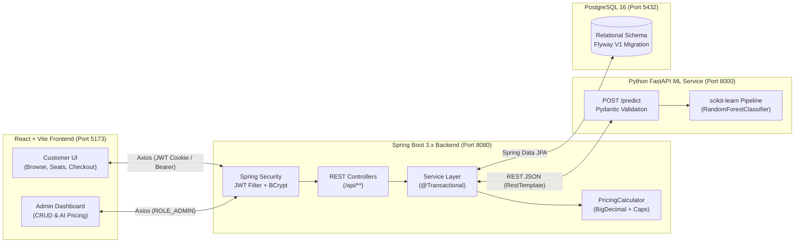
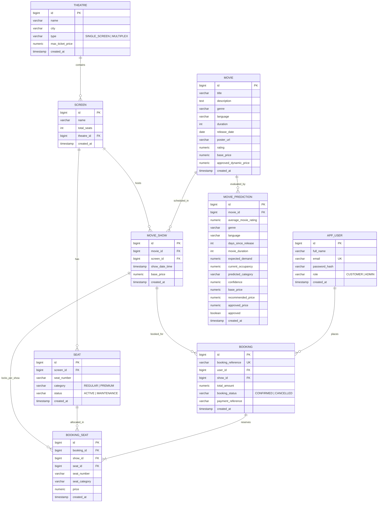

# Movie Booking with AI Dynamic Pricing — Hackathon MVP

A clean, full-stack **Movie Ticket Booking Application with AI-Driven Dynamic Ticket Pricing** built for a final-year engineering project evaluation and hackathon demonstration. The system integrates a **Java 21 + Spring Boot 3.x** backend, **PostgreSQL + Flyway** relational persistence, a **Python 3.11 + FastAPI + scikit-learn** machine learning microservice, and a responsive dark-mode **React + Vite + Tailwind CSS** frontend.

---

## 1. Project Overview

Traditional cinema ticketing platforms rely on static pricing tiers that do not adapt to audience demand, real-time seat occupancy, or critical reception. **CinePulse AI** bridges this gap by combining transactional cinema operations with an explainable **RandomForestClassifier** popularity prediction engine:

- **Customers** browse movies, inspect show timings across **Single-Screen** and **Multiplex** theatres, view real-time auditorium seat availability, select **Regular** or **Premium** seats, complete a transactional booking with a mock payment workflow, and view their booking confirmations and history.
- **Administrators** manage the catalog of movies, theatres, screens, and shows, and use the **AI Dynamic Pricing Dashboard** to send movie features to the FastAPI ML service, inspect the predicted popularity class (`FLOP` through `INDUSTRY_HIT`) and confidence score, verify regulatory theatre price caps (`₹350` for Single-Screen, `₹450` for Multiplex), and approve dynamic ticket prices.

---

## 2. Features

### Authentication & Authorization (`CUSTOMER` & `ADMIN`)
- Public customer registration (`POST /api/auth/register`) strictly enforces the `CUSTOMER` role (never accepts `ADMIN` from public payloads).
- Password hashing using **BCrypt** (`BCryptPasswordEncoder`).
- Stateless **JWT** authentication (`jjwt 0.12.6`) delivered via both **HTTP-only cookie** (`cinepulse_token`) and `Authorization: Bearer <token>` header.
- Role-based endpoint security (`@PreAuthorize` + `SecurityFilterChain`) separating public browsing, customer booking operations, and admin management routes.
- Automatic development account seeding on startup (`admin@cinepulse.com` and `customer@cinepulse.com`).

### Movie, Theatre, Screen & Show Management
- Full CRUD for movies (`title`, `description`, `genre`, `language`, `duration`, `releaseDate`, `posterUrl`, `rating`, `basePrice`, `approvedDynamicPrice`) plus title search.
- Theatre creation supporting `SINGLE_SCREEN` (maximum ticket price cap **₹350.00**) and `MULTIPLEX` (maximum ticket price cap **₹450.00**).
- Screen creation with automatic auditorium seat grid generation (`REGULAR` and `PREMIUM` rows).
- Show scheduling linking a movie, screen, show timestamp, and base ticket price.

### Transactional Seat Selection & Booking Workflow
- Real-time seat map (`GET /api/shows/{id}/seats`) indicating available `REGULAR` and `PREMIUM` seats alongside already-booked seats.
- `@Transactional` booking creation (`POST /api/bookings`) backed by a PostgreSQL unique constraint `uq_booking_seat_show_seat (show_id, seat_id)` to prevent double-booking seats under concurrent requests.
- Authoritative backend ticket price calculation using `BigDecimal`.
- Explicit **Mock Payment** confirmation generating a unique booking reference (`BK-XXXXXXXX`) and payment reference (`MOCK-PAY-XXXXXXXX`).

### AI Dynamic Ticket Pricing (FastAPI + scikit-learn)
- Reproducible synthetic dataset generator (`ml-service/train.py`, fixed seed `42`, 3,500 samples) comparing a **LogisticRegression** baseline against a **RandomForestClassifier** primary model and persisting the pipeline via `joblib`.
- FastAPI inference server (`ml-service/app.py`) exposing `POST /predict` and `GET /health` with Pydantic input validation.
- Spring Boot `AiPricingService` that queries FastAPI, maps the predicted popularity class to its pricing multiplier, enforces configurable minimum and theatre-type maximum caps (`₹350` / `₹450`), stores a full audit trail in `movie_prediction`, and lets the Admin approve the recommended price.

---

## 3. Technology Stack

| Layer | Technology |
| :--- | :--- |
| **Backend** | Java 21, Spring Boot 3.3.4, Spring Web, Spring Security, Spring Data JPA, Bean Validation, Lombok |
| **Authentication** | JWT (`io.jsonwebtoken:jjwt 0.12.6`), BCrypt, HTTP-Only Cookie + Bearer Header |
| **Database & Migration** | PostgreSQL 16 (Docker Compose), Flyway SQL Migrations (`V1__init_schema_and_seed.sql`), H2 (Tests) |
| **AI / ML Service** | Python 3.11+, FastAPI, Uvicorn, scikit-learn, pandas, NumPy, joblib |
| **Frontend** | React 18, Vite 5, React Router v6, Axios, Tailwind CSS |
| **API Documentation** | SpringDoc OpenAPI 3 / Swagger UI (`/swagger-ui.html`) |
| **Testing** | JUnit 5, Mockito, Spring Security Test (`MockMvc`) |

---

## 4. Folder Structure

```text
movie-booking/
│
├── backend/
│   ├── src/main/java/com/example/moviebooking/
│   │   ├── controller/       # REST Controllers (Auth, Movie, TheatreShow, Booking, AdminPricing)
│   │   ├── service/          # Business Logic & FastAPI Integration
│   │   ├── repository/       # Spring Data JPA Repositories
│   │   ├── model/            # JPA Entities & Enums
│   │   ├── dto/              # Request/Response DTOs with Bean Validation
│   │   ├── security/         # JwtTokenProvider, JwtAuthenticationFilter, SecurityConfig
│   │   ├── config/           # OpenApiConfig, AppConfig (RestTemplate), DataInitializer
│   │   ├── exception/        # GlobalExceptionHandler & Custom Exceptions
│   │   └── util/             # PricingCalculator (BigDecimal multipliers & caps)
│   │
│   ├── src/main/resources/
│   │   ├── application.yml
│   │   └── db/migration/
│   │       └── V1__init_schema_and_seed.sql
│   │
│   ├── src/test/java/com/example/moviebooking/
│   │   ├── MovieBookingCoreTests.java
│   │   └── SecurityRoleAuthorizationTests.java
│   └── pom.xml
│
├── frontend/
│   ├── src/
│   │   ├── components/       # Navbar.jsx, ProtectedRoute.jsx
│   │   ├── pages/            # Login, Register, Home, MovieDetails, SeatSelection, Checkout, BookingConfirmation, MyBookings, AdminDashboard
│   │   ├── services/         # api.js (Axios instance + endpoint modules)
│   │   ├── context/          # AuthContext.jsx
│   │   ├── App.jsx
│   │   └── main.jsx
│   ├── index.html
│   ├── vite.config.js
│   └── package.json
│
├── ml-service/
│   ├── app.py                # FastAPI application serving POST /predict & GET /health
│   ├── train.py              # Reproducible synthetic data generator & RandomForest trainer
│   ├── model/                # Saved joblib pipeline & model_metadata.json
│   ├── data/                 # Pre-generated synthetic_movie_pricing_data.csv (3,500 rows)
│   └── requirements.txt
│
├── docker-compose.yml        # PostgreSQL 16 container configuration
├── .env.example              # Environment variable template
└── README.md
```

---

## 5. Architecture Diagram



---

## 6. Database ER Diagram (Mermaid)



---

## 7. Prerequisites

Ensure the following tools are installed on your Windows machine before running the project:
1. **Java 21 JDK** (`java -version` should report 21.x)
2. **Apache Maven 3.9+** (`mvn -version`)
3. **Python 3.11+** (`python --version`)
4. **Node.js 18+ & npm** (`node -v` and `npm -v`)
5. **Docker Desktop** (for running PostgreSQL via `docker compose`, or a local PostgreSQL 15/16 server on port `5432`)

---

## 8. Windows Setup Instructions (Step-by-Step)

Open **PowerShell** or **Command Prompt** in the root `movie-booking/` directory:

```powershell
# 1. Copy the environment configuration template
copy .env.example .env
```

---

## 9. PostgreSQL Setup

### Option A: Using Docker Compose (Recommended)
```powershell
cd movie-booking
docker compose up -d
docker compose ps
```
This starts a PostgreSQL 16 container named `movie-booking-postgres` on `localhost:5432` with database `movie_booking`, user `postgres`, and password `postgres`.

### Option B: Using Local PostgreSQL on Windows (Without Docker)
If you already have PostgreSQL installed locally on Windows, open `psql` or pgAdmin and run:
```sql
CREATE DATABASE movie_booking;
```
Flyway will automatically create all 9 tables and insert the seed data (`5 movies`, `2 theatres`, `3 screens`, `68 seats`, and `6 shows`) when the Spring Boot backend starts.

---

## 10. Python ML Service Setup & Model Training Commands

Open a new **PowerShell** window in `movie-booking/ml-service`:

```powershell
cd movie-booking\ml-service

# 1. Create and activate a Python virtual environment
python -m venv venv
.\venv\Scripts\Activate.ps1

# 2. Install required ML and FastAPI dependencies
pip install -r requirements.txt

# 3. Train the RandomForestClassifier & compare with LogisticRegression baseline
python train.py

# 4. Start the FastAPI server on port 8000
uvicorn app:app --host 0.0.0.0 --port 8000 --reload
```
- FastAPI Health Check: `http://localhost:8000/health`
- FastAPI Interactive Docs: `http://localhost:8000/docs`

---

## 11. Backend Startup & Testing Commands

Open a new **PowerShell** window in `movie-booking/backend`:

```powershell
cd movie-booking\backend

# 1. Run JUnit 5 & Mockito unit and security authorization tests
mvn clean test

# 2. Start the Spring Boot backend on port 8080
mvn spring-boot:run
```
When the backend starts:
- Flyway executes `V1__init_schema_and_seed.sql`.
- `DataInitializer` seeds the `ADMIN` and `CUSTOMER` accounts with BCrypt-hashed passwords.

---

## 12. Frontend Startup Commands

Open a new **PowerShell** window in `movie-booking/frontend`:

```powershell
cd movie-booking\frontend

# 1. Install dependencies
npm install

# 2. Start Vite development server on port 5173
npm run dev

# 3. Verify production bundle build (optional)
npm run build
```
Open your browser at: **`http://localhost:5173`**

---

## 13. API Documentation URL (Swagger / OpenAPI)

Once the Spring Boot backend is running on port `8080`, access Swagger UI at:
- **Swagger UI**: `http://localhost:8080/swagger-ui.html`
- **OpenAPI JSON Spec**: `http://localhost:8080/v3/api-docs`

### Using JWT Authorization in Swagger UI:
1. Call `POST /api/auth/login` with `{"email": "admin@cinepulse.com", "password": "Admin@123"}`.
2. Copy the `accessToken` string from the JSON response.
3. Click the **Authorize** button at the top right of Swagger UI, paste the token into the `bearerAuth` value box, and click **Authorize**.

---

## 14. Development Login Credentials

These accounts are seeded automatically on startup via `DataInitializer.java` and configured in `application.yml` / `.env.example` (also available via one-click **Quick Fill** buttons on the React Login page):

| Role | Email | Password | Capabilities |
| :--- | :--- | :--- | :--- |
| **ADMIN** | `admin@cinepulse.com` | `Admin@123` | Full Admin Dashboard, Movie/Theatre/Screen/Show CRUD, AI Price Prediction & Approval |
| **CUSTOMER** | `customer@cinepulse.com` | `Customer@123` | Browse Movies & Shows, Select Seats, Mock Payment Checkout, View My Bookings |

---

## 15. Sample End-to-End Demo Workflow (For Project Evaluation)

Follow this 5-minute script during your evaluation:

1. **Show the ML Service (`http://localhost:8000/docs`)**:
   - Point out the terminal output of `python train.py` showing the class distribution across the 7 popularity categories, the `LogisticRegression` baseline accuracy vs. `RandomForestClassifier` accuracy, and the saved `movie_popularity_model.joblib`.
2. **Admin Login & AI Dynamic Pricing (`http://localhost:5173/login`)**:
   - Click **Admin Demo** on the Login screen (`admin@cinepulse.com` / `Admin@123`) and sign in.
   - Review the **KPI Summary Cards** (5 Movies, 2 Theatres, 6 Shows, Bookings, Customers).
   - In **Tab 1: AI Dynamic Pricing Engine**, select **Kalki 2898 AD** (Base Price `₹250.00`), set `Expected Demand = 92%` and `Current Occupancy = 88%`, and click **Predict Ticket Price**.
   - Show the live response from FastAPI (`BLOCKBUSTER` or `SUPERHIT`, confidence percentage, Single-Screen cap `₹350.00`, Multiplex cap `₹450.00`).
   - Click **Approve Recommended Price** and show that the movie's active price updates immediately.
3. **Admin Catalog Management**:
   - Briefly switch to **Tab 2 (Movies)**, **Tab 3 (Theatres & Screens)**, and **Tab 4 (Shows)** to demonstrate adding a screen or scheduling a show.
4. **Customer Seat Selection & Transactional Booking**:
   - Click **Logout**, then sign in using **Customer Demo** (`customer@cinepulse.com` / `Customer@123`) or register a new customer account.
   - Search for **Kalki 2898 AD** on the Home screen and notice the green **AI Price Active** badge.
   - Click **View Shows →**, compare the Single-Screen (`Sudarshan 35MM`, capped at `₹350`) and Multiplex (`PVR Inorbit IMAX`, capped at `₹450`) show prices, and click **Select Seats**.
   - Pick `A1` (Regular) and `C1` (Premium), proceed to **Checkout**, select `UPI Instant Pay (Mock)`, and click **Pay & Confirm**.
5. **Verify Duplicate Seat Prevention & Booking History**:
   - View the **Booking Confirmation** page (`BK-XXXXXXXX`), check **My Bookings**, and return to the same show's seat map to show that seats `A1` and `C1` are now marked **Sold / Booked** and cannot be selected again.

---

## 16. Explanation of AI Dynamic Pricing Logic

### Input Features Sent to FastAPI (`POST /predict`)
- `averageMovieRating` (`1.0` – `10.0`)
- `genre` (`ACTION`, `SCI_FI`, `DRAMA`, `THRILLER`, `COMEDY`, `HORROR`, `ROMANCE`, `FANTASY`)
- `language` (`TELUGU`, `HINDI`, `ENGLISH`, `TAMIL`, `MALAYALAM`, `KANNADA`)
- `daysSinceRelease` (`>= 0`)
- `movieDuration` (minutes)
- `expectedDemand` (`0.0` – `100.0%`)
- `currentOccupancy` (`0.0` – `100.0%`)

### Popularity Classes & Multipliers (`PricingCalculator.java`)
| Predicted Category | Multiplier | Formula (`BigDecimal`) |
| :--- | :---: | :--- |
| `FLOP` | `0.75x` | `basePrice * 0.75` |
| `BELOW_AVERAGE` | `0.90x` | `basePrice * 0.90` |
| `AVERAGE` | `1.00x` | `basePrice * 1.00` |
| `HIT` | `1.25x` | `basePrice * 1.25` |
| `SUPERHIT` | `1.50x` | `basePrice * 1.50` |
| `BLOCKBUSTER` | `1.65x` | `basePrice * 1.65` |
| `INDUSTRY_HIT` | `1.80x` | `basePrice * 1.80` |

### Regulatory & Theatre Price Caps
After multiplying `basePrice * multiplier`, Spring Boot applies strict floor and ceiling rules:
- **Minimum Ticket Price Floor**: Configurable via `PRICING_MIN_TICKET_PRICE` (default `₹120.00`).
- **Single-Screen Maximum Cap**: `₹350.00` (`SINGLE_SCREEN`).
- **Multiplex Maximum Cap**: `₹450.00` (`MULTIPLEX`).
- **Theatre-Specific Cap**: Never exceeds `theatre.maxTicketPrice`.

> **IMPORTANT SYNTHETIC DATASET DISCLAIMER**:
> The dataset generated by `ml-service/train.py` (`ml-service/data/synthetic_movie_pricing_data.csv`) is **synthetic** and created with a fixed random seed (`42`) specifically to demonstrate a real, working end-to-end machine learning integration between Spring Boot and FastAPI using `scikit-learn`. Its classification accuracy metrics do not represent real-world box-office performance or commercial cinema data.

---

## 17. Limitations & Future Enhancements

1. **Synthetic Training Data**: Replace synthetic data with historical ticketing, occupancy, and box-office datasets.
2. **Temporary Seat Hold TTL**: Currently uses a transactional check and a PostgreSQL unique constraint `(show_id, seat_id)` on checkout; can be extended with a 5-minute temporary seat lock table or Redis TTL for high-concurrency flash sales.
3. **Payment Gateway**: Uses an explicit mock payment confirmation for hackathon evaluation; can be integrated with Razorpay/Stripe webhooks.
4. **PDF / QR Ticket Export**: Add downloadable QR-coded PDF tickets upon booking confirmation.
