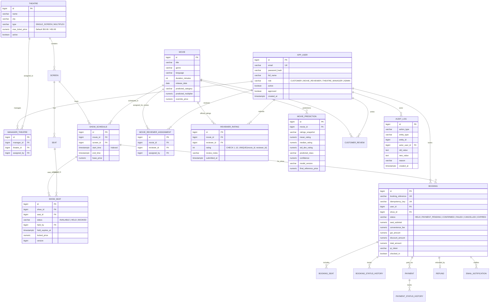

# Movie Ticket Booking with AI Dynamic Pricing

A clean, resume-worthy full-stack portfolio project built with **Java 21**, **Spring Boot 3.2**, **PostgreSQL 16 (Flyway)**, **FastAPI + scikit-learn**, and **React + Vite**. Designed for clarity, strict role-based security, pessimistic database concurrency control, and an audited 10-reviewer AI dynamic pricing pipeline—without microservices, Kafka, Redis, or over-engineering.

## Project Folder Structure

```text
movie-booking/
├── backend/                  # Spring Boot 3.x, Java 21, Maven
│   ├── src/main/java/com/example/moviebooking/
│   │   ├── controller/       # REST controllers (no business logic)
│   │   ├── service/          # Business logic + @Transactional
│   │   ├── repository/       # Spring Data JPA + @Lock(PESSIMISTIC_WRITE)
│   │   ├── model/            # JPA entities + string-mapped enums
│   │   ├── dto/              # Request/response Java records + validation
│   │   ├── security/         # JWT filter, util, SecurityConfig, ownership checks
│   │   ├── exception/        # Custom exceptions + GlobalExceptionHandler
│   │   ├── config/           # AppProperties, Swagger OpenApiConfig, RestTemplate
│   │   ├── email/            # @Async email service + HTML template + retry scheduler
│   │   └── util/             # OpenPDF ticket generator, ZXing QR code & HMAC helper
│   ├── src/main/resources/   # application.yml, db/migration (Flyway V1 & V2)
│   ├── src/test/java/...     # JUnit 5, Mockito, MockMvc & 10-thread concurrency tests
│   └── pom.xml
├── frontend/                 # React 18 + Vite + Axios (4 role dashboards)
│   ├── public/
│   └── src/                  # pages, components, api, context
├── ml-service/               # FastAPI + scikit-learn service
│   ├── app.py                # POST /predict and GET /health endpoints
│   ├── train.py              # RandomForest vs LogisticRegression baseline trainer
│   ├── data/                 # Fixed-seed synthetic dataset generator & CSV
│   ├── model/                # Saved model (.joblib)
│   └── requirements.txt
├── docker-compose.yml        # PostgreSQL 16 (and optional pgAdmin profile)
├── .env.example              # Environment variable template
└── README.md
```

## Database Schema & ER Diagram (Mermaid)

All monetary amounts use `NUMERIC(10, 2)` (`BigDecimal`), all enums are stored as `VARCHAR` strings with database `CHECK` constraints, and all timestamps are stored in UTC (`TIMESTAMPTZ`) and formatted in `IST (Asia/Kolkata)` for display.



## Implementation Phases Summary

| Phase | Scope | Key Files Built |
| :--- | :--- | :--- |
| **P1** | Setup, PostgreSQL Docker & Flyway Schema | `docker-compose.yml`, `.env.example`, `backend/pom.xml`, `V1__init_schema.sql`, `V2__seed_data.sql` |
| **P2** | Auth, 4-Role RBAC & Ownership Checks | `JwtUtil.java`, `JwtAuthenticationFilter.java`, `SecurityConfig.java`, `OwnershipVerifier.java`, `AuthService.java`, `GlobalExceptionHandler.java` |
| **P3** | Catalog, Theatres, Screens & Non-Overlapping Shows | `CatalogService.java`, `CatalogController.java`, `TimeUtil.java` |
| **P4** | Pessimistic Seat Hold Engine & Scheduled Expiry | `SeatHoldService.java`, `ShowSeatRepository.java` (`@Lock(PESSIMISTIC_WRITE)`) |
| **P5** | Booking, Coupons, Mock/Razorpay Payment & Idempotency | `BookingService.java`, `PaymentGateway.java`, `MockPaymentGateway.java`, `RazorpayPaymentGateway.java` |
| **P6** | PDF Ticket, Signed QR Token, `@Async` Email & Retry | `PdfTicketGenerator.java`, `QrCodeHelper.java`, `TicketEmailService.java`, `EmailTemplateBuilder.java` |
| **P7** | 10-Reviewer Gate, FastAPI ML Service & Pricing Engine | `ReviewerService.java`, `PricingService.java`, `ml-service/data/generate_dataset.py`, `ml-service/train.py`, `ml-service/app.py` |
| **P8** | React + Vite Frontend (4 Role Sections) | `CustomerDashboard.jsx`, `ReviewerDashboard.jsx`, `ManagerDashboard.jsx`, `AdminDashboard.jsx`, `ProtectedRoute.jsx` |
| **P9** | JUnit 5 / MockMvc Test Suite & Documentation | `PricingAndCapTest.java`, `SeatConcurrencyAndBookingFlowTest.java`, `RbacAndReviewerFlowTest.java`, `README.md` |

## Prerequisites

- **Java 21** (OpenJDK 21+)
- **Maven 3.9+**
- **Python 3.11+** (with `pip` and `venv`)
- **Node.js 18+** and `npm`
- **Docker Desktop** (for running PostgreSQL 16 via `docker compose`)

## Windows Setup & Run Guide (Step-by-Step)

### 1. Clone & Configure Environment Variables

Open PowerShell in the `movie-booking` root folder and copy `.env.example` to `.env`:

```powershell
Copy-Item .env.example .env
```

| Environment Variable | Default Development Value | Purpose |
| :--- | :--- | :--- |
| `DB_URL` | `jdbc:postgresql://localhost:5432/moviebooking` | PostgreSQL JDBC URL |
| `DB_USERNAME` | `postgres` | Database username |
| `DB_PASSWORD` | `postgres` | Database password |
| `JWT_SECRET` | `dev-only-jwt-secret-key-change-in-prod-9876543210abcdef` | HMAC-SHA256 signing key for 1-hour JWT access tokens |
| `TICKET_QR_SECRET` | `dev-only-qr-hmac-secret-key-change-in-prod-1234567890` | HMAC-SHA256 key for signing QR ticket tokens |
| `MAIL_HOST` / `MAIL_PORT` | `sandbox.smtp.mailtrap.io` / `2525` | SMTP server (Mailtrap for local dev or Gmail SMTP) |
| `ML_SERVICE_URL` | `http://localhost:8000` | FastAPI ML prediction service endpoint |
| `PAYMENT_GATEWAY_PROVIDER` | `MOCK` | `MOCK` (default) or `RAZORPAY` (optional test mode) |
| `HOLD_EXPIRY_MINUTES` | `5` | Seat hold lock duration before automatic release |
| `CANCELLATION_CUTOFF_HOURS` | `2` | Cutoff window before showtime for customer cancellations |

### 2. Start PostgreSQL Database

```powershell
docker compose up -d
```

To also start **pgAdmin** on `http://localhost:5050` (optional):

```powershell
docker compose --profile tools up -d
```

### 3. Train & Run the FastAPI ML Service (`ml-service`)

> **Synthetic Data Disclaimer:** The dataset generated by `data/generate_dataset.py` is synthetic (fixed random seed `42`). Therefore, the classification accuracy printed by `train.py` is **not** real-world box-office accuracy. The feature pipeline and model artifact (`model/pricing_classifier.joblib`) are designed so real historical reviewer and box-office datasets can drop in without changing the Java or FastAPI integration.

```powershell
cd ml-service
python -m venv .venv
.\.venv\Scripts\Activate.ps1
pip install -r requirements.txt

# 1. Generate reproducible synthetic dataset (2,500 rows)
python data/generate_dataset.py

# 2. Train LogisticRegression baseline + RandomForestClassifier and save .joblib model
python train.py

# 3. Start FastAPI server on http://localhost:8000
uvicorn app:app --host 0.0.0.0 --port 8000 --reload
```

### 4. Build, Test & Run the Spring Boot Backend (`backend`)

Open a new PowerShell window:

```powershell
cd backend

# Run all JUnit 5 unit, concurrency, RBAC, and MockMvc tests
mvn clean test

# Start the Spring Boot backend on http://localhost:8080
mvn spring-boot:run
```

- **Swagger UI:** `http://localhost:8080/swagger-ui.html` (or `http://localhost:8080/swagger-ui/index.html`)
- **OpenAPI JSON:** `http://localhost:8080/v3/api-docs`

### 5. Run the React + Vite Frontend (`frontend`)

Open a third PowerShell window:

```powershell
cd frontend
npm install
npm run dev
```

Open `http://localhost:5173` in your browser.

## Seeded Development Accounts (DEVELOPMENT ONLY — Never Use in Production)

Flyway migration `V2__seed_data.sql` seeds the following accounts for local testing and demonstration. Every seeded dev account uses the password: **`Password@123`**

| Role | Email | Assigned Scope / Notes |
| :--- | :--- | :--- |
| `ADMIN` | `admin@moviebooking.local` | Full platform management, reviewer assignment, AI prediction trigger, price overrides, audit logs |
| `THEATRE_MANAGER` | `manager@moviebooking.local` | Assigned to **Orion Multiplex IMAX** (`theatre_id = 1`); cannot modify **Sudarshan 35MM Single Screen** (`theatre_id = 2`) |
| `CUSTOMER` | `customer@moviebooking.local` | Public browsing, seat holds, booking, coupon checkout, PDF ticket download, customer reviews |
| `MOVIE_REVIEWER` (#1–#9) | `reviewer1@moviebooking.local` .. `reviewer9@moviebooking.local` | Assigned to Movie #1 (*Devara: Storm Horizon*) with ratings `1..9` already submitted in seed data |
| `MOVIE_REVIEWER` (#10) | `reviewer10@moviebooking.local` | Assigned to Movie #1 (*Devara: Storm Horizon*) with rating **pending** so you can submit the 10th rating live in the demo |

## End-to-End Demo Workflow

Follow these steps to demonstrate the complete 4-role workflow from movie creation and 10-reviewer rating to AI dynamic pricing, seat locking, PDF/QR ticket generation, and staff check-in:

1. **Inspect Initial 9/10 Progress as Admin:**
   - Log in at `http://localhost:5173/login` using the **Admin** quick-fill button (`admin@moviebooking.local` / `Password@123`).
   - Select Movie #1 (*Devara: Storm Horizon*). Notice submission progress shows **`9 / 10 Submitted`**.
   - Click **Run AI Price Prediction** right now: the backend prediction gate refuses with HTTP `400 Bad Request` because only 9 of the 10 assigned reviewers have submitted ratings.
2. **Submit the 10th Official Rating as Reviewer #10:**
   - Log out and click the **Reviewer #10** quick-fill button (`reviewer10@moviebooking.local` / `Password@123`).
   - In the **Reviewer Portal**, locate *Devara: Storm Horizon* (`PENDING SUBMISSION`), enter a rating of `9` (and optional notes), and click **Submit Rating**.
   - Notice the row immediately locks to **`SUBMITTED (LOCKED)`** (read-only). Any correction now requires an Admin audited action.
3. **Trigger AI Dynamic Pricing as Admin:**
   - Log back in as **Admin** (`admin@moviebooking.local`).
   - Progress for *Devara: Storm Horizon* now shows **`10 / 10 Submitted — Ready for AI Prediction`**.
   - Click **Run AI Price Prediction**. Java computes `mean`, `median`, `stdDev`, `min`, `max`, `count >= 8`, and `daysSinceRelease`, calls FastAPI `POST /predict`, receives the predicted class (e.g. `SUPERHIT` or `BLOCKBUSTER`) and confidence, updates the movie's multiplier, and writes a snapshot to `movie_prediction` and `audit_log`.
   - Optionally test **Manual Price Override** or **Audited Rating Correction** and verify the new row in the **Platform Audit Trail** table at the bottom of the Admin Console.
4. **Create a Show as Theatre Manager:**
   - Log in as **Theatre Manager** (`manager@moviebooking.local`).
   - Select **Orion Multiplex IMAX** (`MULTIPLEX`, Cap `INR 450.00`).
   - Schedule a new show for *Devara: Storm Horizon* on `Screen 1 - Dolby Atmos` with a base price of `200.00` (validated against `[100.00, 450.00]` and checked for non-overlapping showtimes).
5. **Hold Seats, Apply Coupon & Book Ticket as Customer:**
   - Log in as **Customer** (`customer@moviebooking.local`).
   - Select *Devara: Storm Horizon*, view the show's **AI Dynamic Regular Price**, and click **Select Seats**.
   - Pick seats `A1` and `A2` and click **Hold Selected Seats**. A 5-minute countdown starts and locks the seat price onto `show_seat.locked_price`.
   - Enter coupon `WELCOME10`, click **Proceed to Checkout**, review the server-side breakdown (Seat Subtotal, Discount, 5% Convenience Fee, 18% GST, Total), and click **Pay Now (Mock Payment Gateway)**.
6. **Download PDF/QR Ticket & Validate Check-In as Theatre Manager:**
   - In **My Bookings**, click **PDF Ticket** to download the generated PDF containing the movie, theatre, screen, IST showtime, seat codes, amount, and embedded QR code.
   - Copy the `qrToken` from the booking (or scan the QR code), log in as **Theatre Manager** (`manager@moviebooking.local`), paste the token into **Staff QR Ticket Validation**, and click **Validate & Check In**.
   - Try validating the same QR token a second time: the backend rejects it with `409 Conflict` (`Ticket has already been checked in`).

## Architecture & Design Notes

### 1. Seat Selection & Concurrency (`SELECT ... FOR UPDATE`)
- **Approach:** When a customer calls `POST /api/bookings/hold`, `SeatHoldService.holdSeats()` runs inside a single `@Transactional` boundary and executes `ShowSeatRepository.findAndLockByShowIdAndSeatIds()`, which issues a `SELECT ... FROM show_seat WHERE show_id = :showId AND seat_id IN (:seatIds) ORDER BY seat_id ASC FOR UPDATE` (`@Lock(LockModeType.PESSIMISTIC_WRITE)`).
- **Deadlock Prevention & All-or-Nothing Semantics:** Sorting `seat_id ASC` before acquiring row locks guarantees a consistent lock acquisition order across concurrent transactions, preventing circular deadlocks when two users select overlapping multi-seat combinations (e.g., `[A1, A2]` vs `[A2, A3]`). If any requested seat is already held (and not expired) or booked, the transaction throws `ConflictException` and rolls back all locks atomically.
- **Dual Expiry Handling:** A `@Scheduled` job (`releaseExpiredHoldsJob`) runs every 30 seconds to reset expired `HELD` seats back to `AVAILABLE`. Additionally, `ShowSeat.isEffectivelyAvailable(now)` treats any hold whose `hold_expires_at < now` as immediately available during lock evaluation so users never wait for the next scheduler tick.
- **Database-Level Safety Net:** In addition to row locking on `show_seat`, `V1__init_schema.sql` creates a partial unique index `uk_confirmed_show_seat ON booking_seat(show_id, seat_id) WHERE confirmed_active = TRUE` so the database itself guarantees a seat can never belong to two `CONFIRMED` bookings for the same show.
- **Single-DB Limits:** Because `SELECT ... FOR UPDATE` relies on PostgreSQL row-level locks within a single primary database instance, it works cleanly for a monolith backed by one PostgreSQL primary. In a multi-region or sharded database setup, row locks would need to be complemented by distributed locks (e.g. Redis Redlock) or partition-aware routing.

### 2. AI Dynamic Pricing & Theatre Price Caps
- **10-Reviewer Gate:** Official pricing ratings are completely separate from normal 1–5 star customer reviews. Admin must assign exactly 10 distinct `MOVIE_REVIEWER` accounts to a movie (`UNIQUE(movie_id, reviewer_id)`), and all 10 must submit their `1..10` rating before `PricingService.triggerMoviePrediction()` allows calling the FastAPI service.
- **Category Multipliers & Clamping:** Each predicted class (`FLOP`, `BELOW_AVERAGE`, `AVERAGE`, `HIT`, `SUPERHIT`, `BLOCKBUSTER`, `INDUSTRY_HIT`) maps to a configurable multiplier stored in `global_pricing_policy` (defaults for a ₹200 base: `0.75x -> ₹150`, `0.90x -> ₹180`, `1.00x -> ₹200`, `1.25x -> ₹250`, `1.50x -> ₹300`, `1.65x -> ₹330`, and `INDUSTRY_HIT -> theatre.maxTicketPrice`). The final seat price is strictly clamped via `clamp(candidatePrice, minTicketPrice, theatre.maxTicketPrice)` so the AI or seat category multiplier can **never** exceed the theatre cap (`₹350` default for `SINGLE_SCREEN`, `₹450` default for `MULTIPLEX`).
- **Price Immutability:** When a user holds seats, the calculated dynamic price is written to `show_seat.locked_price`, and upon booking initiation it is copied to `booking_seat.price` and `booking.total_amount`. Any subsequent AI re-prediction or Admin price override applies only to new seat holds; existing holds and confirmed bookings never change price.

### 3. Payment Gateway & Idempotency
- **Idempotency Keys:** `POST /api/bookings/initiate` requires an `idempotencyKey` (`UNIQUE` column on `booking` and `payment`). Retrying a network request with the same key returns the existing `BookingInitResponse` without creating duplicate orders or double-charging.
- **Pluggable PaymentGateway:** `MockPaymentGateway` is active by default (`app.payment.provider=MOCK`) and verifies payments using server-side HMAC-SHA256 signatures (`orderId|paymentId`). `RazorpayPaymentGateway` is included behind `@ConditionalOnProperty(name = "app.payment.provider", havingValue = "RAZORPAY")`.

### 4. Extended 4-Role RBAC & Ownership Enforcement
- **No Privilege Escalation:** Public registration (`POST /api/auth/register`) always assigns `Role.CUSTOMER` regardless of any role string sent in the payload. Privileged accounts (`MOVIE_REVIEWER`, `THEATRE_MANAGER`, `ADMIN`) can only be created by an `ADMIN`.
- **Service-Level Ownership Verification:** `OwnershipVerifier` checks `manager_theatre` on every screen, show, analytics, and QR ticket validation call so a `THEATRE_MANAGER` can never modify or validate tickets for an unassigned theatre. Similarly, reviewer identity always comes from the JWT (`@AuthenticationPrincipal`), preventing reviewer impersonation.
